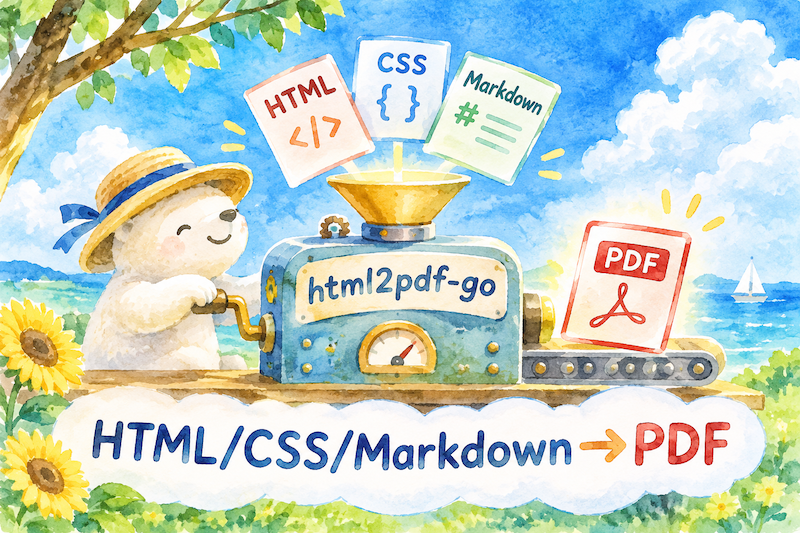

# html2pdf-go - HTML/CSS/Markdown→PDF

[English README](README.md)

HTML/CSS/Markdown→PDFの変換ライブラリとCLIです。HTML/CSSの主要タグをサポートすることで、それなりに見栄えの良いPDFを手軽に作成できます。Pure Go言語で実装しているので、実行ファイル1つで、ブラウザ依存もなく、手軽に使える小さなツールです。

## インストール

```sh
# Linux / macOS
curl -fsSL https://raw.githubusercontent.com/kujirahand/html2pdf-go/main/scripts/install.sh | sh
```

```powershell
# Windows (PowerShell)
irm https://raw.githubusercontent.com/kujirahand/html2pdf-go/main/scripts/install.ps1 | iex
```

バイナリは署名されていないため、ブラウザでダウンロードすると OS にブロックされます（Gatekeeper / SmartScreen）。これらのスクリプトでインストールすればブロックを避けられ、インストール前に SHA-256 チェックサムも検証します。

## チュートリアル

CLI で HTML ファイルを 1 つ PDF に変換する手順を [docs/tutorial-ja.md](docs/tutorial-ja.md) にまとめました。どんな PDF が作れるかは、サンプル文書のカタログ [examples/README.md](examples/README.md) もご覧ください。

## ライブラリとしての使い方

```sh
go get github.com/kujirahand/html2pdf-go
```

```go
package main

import (
	"bytes"
	"log"
	"os"

	html2pdf "github.com/kujirahand/html2pdf-go"
)

func main() {
	var buf bytes.Buffer
	src := []byte("<h1>Hello</h1><p>こんにちは</p>")
	if err := html2pdf.Convert(src, &buf, &html2pdf.Options{PageSize: "A4"}); err != nil {
		log.Fatal(err)
	}
	if err := os.WriteFile("out.pdf", buf.Bytes(), 0o644); err != nil {
		log.Fatal(err)
	}
}
```

## CLI の使い方

```sh
go install github.com/kujirahand/html2pdf-go/cmd/html2pdf@latest

html2pdf input.html                    # input.pdf を出力
html2pdf -o out.pdf -page-size A4 input.html
html2pdf -page-width 91 -page-height 55 input.html   # ページサイズをミリメートルで指定
html2pdf -scale 0.95 input.html        # 内容を 95% に縮小
html2pdf -e '<h1>Hello</h1>'           # HTML を直接指定。output.html と output.pdf を出力
html2pdf -format png input.html        # input.png を出力（PNG 画像出力）
```

`-e <HTML>` を使うと、コマンドラインで直接渡した HTML を変換できます。デバッグに便利です。渡したソースはカレントディレクトリの `output.html` にも書き出され、画像や CSS の相対パスはカレントディレクトリを基準に解決されます。PDF は `-o` のパスに、`-o` を省略すると `output.pdf` に出力されます。`-e` は入力ファイルと同時には指定できません。

既定では、文書が読めるファイル（画像・スタイルシート・フレーム文書）は文書自身のフォルダ（`BaseDir`）の内側にあるものだけです。フォルダの外を指す絶対パスや `..`、`//host/share` のようなネットワークパスは拒否されます。信頼できる文書では、`-allow-external-files`（ライブラリでは `Options.AllowExternalFiles`）でこの制限を解除できます。

`-format png` を指定すると、PDF の代わりにページごとの PNG 画像を出力します（複数ページの場合は `.png` の前に `-1`、`-2`、... が付きます）。解像度は `-png-scale` で、72dpi のポイントに対する倍率を指定します（既定 2、つまり 144dpi）。`-format` を省略して `-o` に `.png` の名前を付けても PNG 出力になります。Go のプログラムからは `html2pdf.ConvertPNG` / `html2pdf.ConvertMarkdownPNG` が使え、ページごとの PNG を返します。

`-scale`（ライブラリでは `Options.Scale`）は内容の縮小・拡大率です（既定 1.0）。wkhtmltopdf の zoom / smart shrinking や Chrome の printToPDF の `scale` に相当する調整機能で、実寸ではわずかに次のページへ溢れる文書を収めたいときに使います。

## Markdown から PDF へ（md2pdf）

`md2pdf` は Markdown ファイルを PDF に変換します。[goldmark](https://github.com/yuin/goldmark) で Markdown を HTML にし、同じエンジンに渡します（Markdown → HTML → PDF）。

```sh
go install github.com/kujirahand/html2pdf-go/cmd/md2pdf@latest

md2pdf input.md                        # input.pdf を出力
md2pdf -o out.pdf -margin 48 input.md
md2pdf -css style.css input.md         # 既定のスタイルシートの後ろに自分の CSS を追加
md2pdf -footer "{title}  —  {page}/{pages}" input.md   # ページ番号つきのヘッダー・フッター
```

`html2pdf` と同じフラグ（`-o`、`-page-size`、`-page-width`、`-page-height`、`-landscape`、`-scale`、`-margin`、`-header`、`-footer`、`-font`、`-font-bold`、`-font-dirs`、`-allow-external-files`、`-format`、`-png-scale`、`-verbose`）に加えて `-css` が使えます。画像の相対パスは Markdown ファイルのあるフォルダを基準に解決されます。

Go のプログラムからは次のように使います。

```go
// Markdown のバイト列から PDF のバイト列へ
err := html2pdf.ConvertMarkdown(src, &buf, &html2pdf.Options{PageSize: "A4", MarkdownCSS: "h1 { color: #205090; }"})

// Markdown ファイルから PDF ファイルへ（BaseDir の既定値は Markdown ファイルのあるフォルダ）
err = html2pdf.ConvertMarkdownFile("input.md", "out.pdf", nil)

// 既定のスタイルシートを埋め込んだ HTML 文書だけを得る
htmlDoc, err := html2pdf.MarkdownToHTML(src)
```

対応する Markdown: 見出し、段落、太字、リスト（入れ子を含む）、タスクリスト、引用、フェンス付き・インデント形式のコードブロック、GFM の表、水平線、リンク、画像、生の HTML。

制限:

- 斜体のフェースがないため、強調は通常の文字で描かれます。
- コードブロックは（`<pre>` ブロックの変換により）改行とインデントを保ちますが、等幅フォントにはなりません。
- Markdown 中の生の HTML はそのまま通るため、信頼できる入力だけを変換してください。

詳しくは [docs/markdown-ja.md](docs/markdown-ja.md) を参照してください。

## 開発

タスクランナー [just](https://github.com/casey/just) を使います。`just` だけでレシピ一覧を表示します。

```sh
just test      # go test ./...
just make      # ネイティブの CLI バイナリを bin/ に生成
just fonts     # IPAex フォントを fonts/ に取得（取得済みなら何もしない）
just samples   # サンプル PDF 一式を out/ に生成
```

## 対応範囲とロードマップ

[docs/architecture-ja.md](docs/architecture-ja.md)（English: [docs/architecture.md](docs/architecture.md)）を参照してください。

対応する HTML 要素・CSS の一覧は [docs/reference-ja.md](docs/reference-ja.md)（English: [docs/reference.md](docs/reference.md)）を参照してください。

## ライセンス

MIT ライセンスです。詳細は `LICENSE` ファイルを参照してください。
