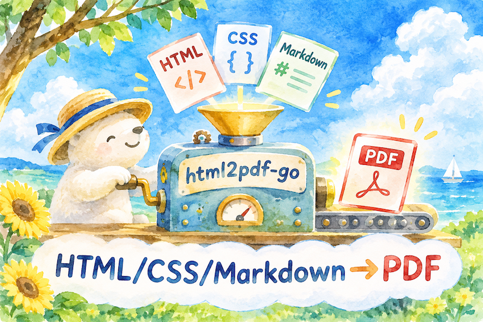

# html2pdf-go - HTML/CSS/Markdown→PDF

[日本語版 README](README-ja.md)

A library and CLI for converting HTML/CSS/Markdown to PDF. By supporting the major HTML/CSS tags, it makes it easy to create reasonably good-looking PDFs. Implemented in pure Go, it is a small, handy tool that runs as a single executable with no browser dependency.

## Install

```sh
# Linux / macOS
curl -fsSL https://raw.githubusercontent.com/kujirahand/html2pdf-go/main/scripts/install.sh | sh
```

```powershell
# Windows (PowerShell)
irm https://raw.githubusercontent.com/kujirahand/html2pdf-go/main/scripts/install.ps1 | iex
```

The binaries are unsigned, so downloading them in a browser makes the OS block them (Gatekeeper / SmartScreen); installing with these scripts avoids that, and they verify the SHA-256 checksum before installing.

## Examples

See the sample catalog [examples/README.md](examples/README.md) (in Japanese) for the kinds of PDFs it can create.

## Using the CLI

```sh
go install github.com/kujirahand/html2pdf-go/cmd/html2pdf@latest

html2pdf input.html                    # writes input.pdf
html2pdf -o out.pdf -page-size A4 input.html
html2pdf -e '<h1>Hello</h1>'           # HTML given directly; writes output.html and output.pdf
html2pdf -format png input.html        # writes input.png (PNG image output)
```

Markdown files are converted with `md2pdf`:

```sh
go install github.com/kujirahand/html2pdf-go/cmd/md2pdf@latest

md2pdf input.md                        # writes input.pdf
md2pdf -css style.css input.md         # appends your CSS after the default stylesheet
```

The full flag list is in [docs/reference.md](docs/reference.md), and the Markdown details are in [docs/markdown.md](docs/markdown.md).

## Supported HTML/CSS/Markdown

- HTML: document structure (`div`, `section`, `center`, `page-break`, ...), headings and paragraphs, lists, tables (including nested ones), images (PNG/JPEG/GIF), and frames (`frameset`, `iframe`). Full list: [docs/reference.md](docs/reference.md).
- CSS: class, ID, element and descendant selectors; fonts, colors, backgrounds, margin and padding, borders (including `border-radius`), `width`, `text-align` and `line-height`; page breaks through `page-break-after`. Full list: [docs/reference.md](docs/reference.md).
- Markdown: headings, bold, lists (including nested and task lists), blockquotes, code blocks, GFM tables, horizontal rules, links, images and raw HTML. Full list: [docs/markdown.md](docs/markdown.md).

Not supported: `float`, `position`, flex and grid layout, `@media` / `@font-face`, attribute selectors and pseudo-classes, italic, and JavaScript.

## Documentation

- [Tutorial](docs/tutorial.md): convert one HTML file to PDF with the CLI.
- [Library guide](docs/library.md): use html2pdf-go as a Go library.
- [Support reference](docs/reference.md): supported HTML elements, CSS and conversion options.
- [Markdown](docs/markdown.md): how Markdown is converted (md2pdf).
- [Architecture](docs/architecture.md): design and conversion pipeline.
- [Development](docs/development.md): development tasks with `just`.

## License

MIT License. See the `LICENSE` file for details.
